# mdwa

A Midnight wallet as a Chrome (MV3) extension. It uses Midnight's own wallet
SDK (`@midnightntwrk/wallet-sdk` 2.0.1, ledger 9) against a Midnight node RPC
and a Midnight indexer. Keys, addresses, sync, transaction balancing, proving
and serialization are the SDK's and the ledger's WebAssembly; nothing of
Midnight is re-implemented here. It works on Preview, Preprod, Mainnet and
Undeployed (a local network), with a separate wallet on each.

The wallet holds three kinds of balance: unshielded (NIGHT and public tokens),
shielded (private tokens) and DUST, the fee resource that NIGHT generates once
it is registered for it. For dApps it implements the Midnight DApp Connector
API 4.1.0 on `window.midnight`.

<table>
  <tr>
    <td>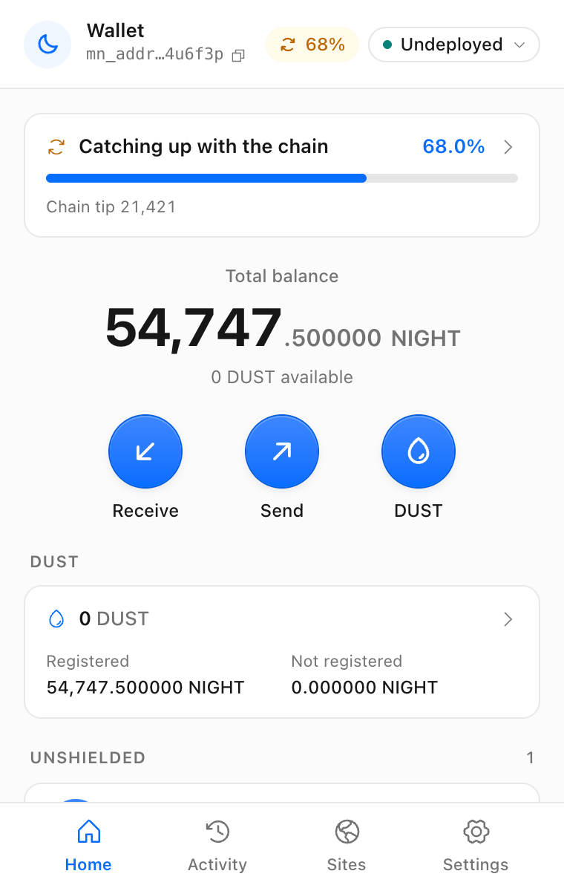</td>
    <td>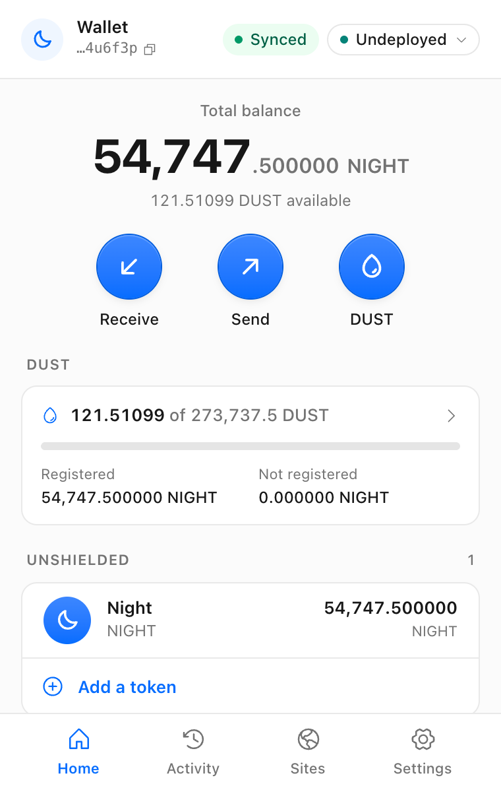</td>
    <td>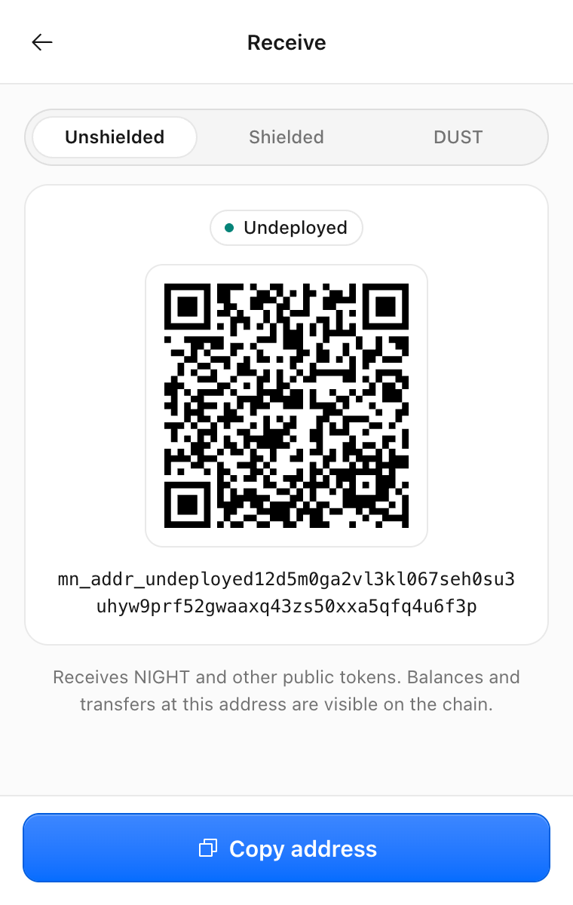</td>
  </tr>
  <tr>
    <td>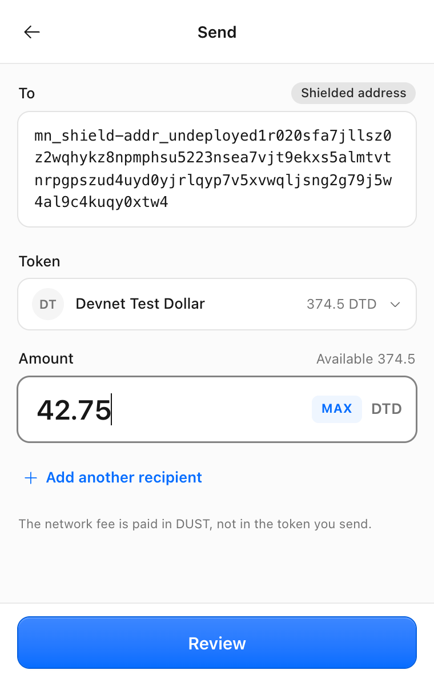</td>
    <td>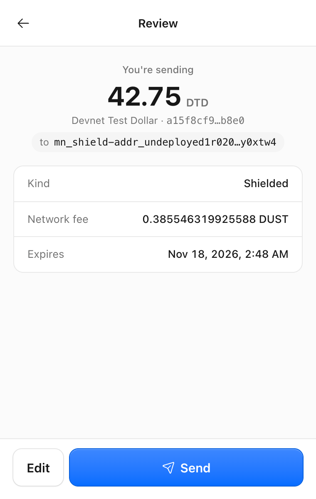</td>
    <td>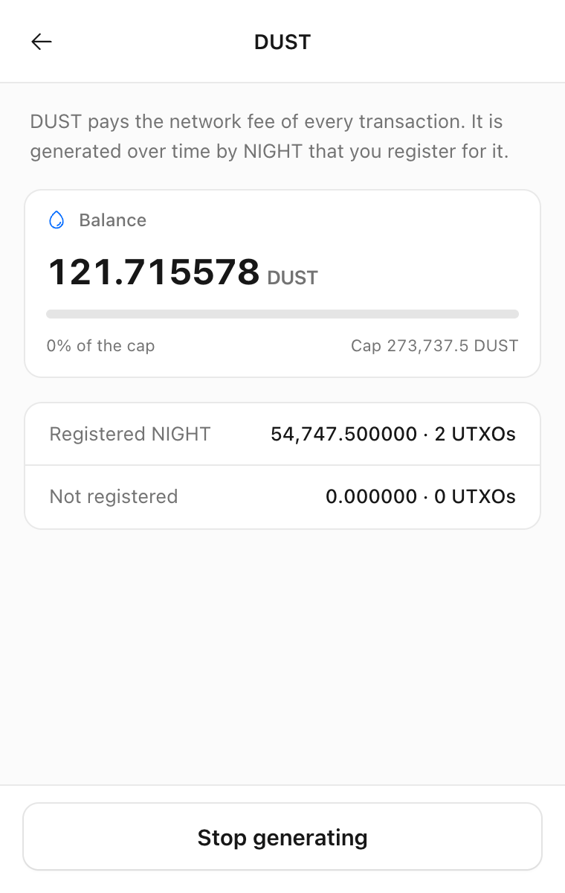</td>
  </tr>
  <tr>
    <td>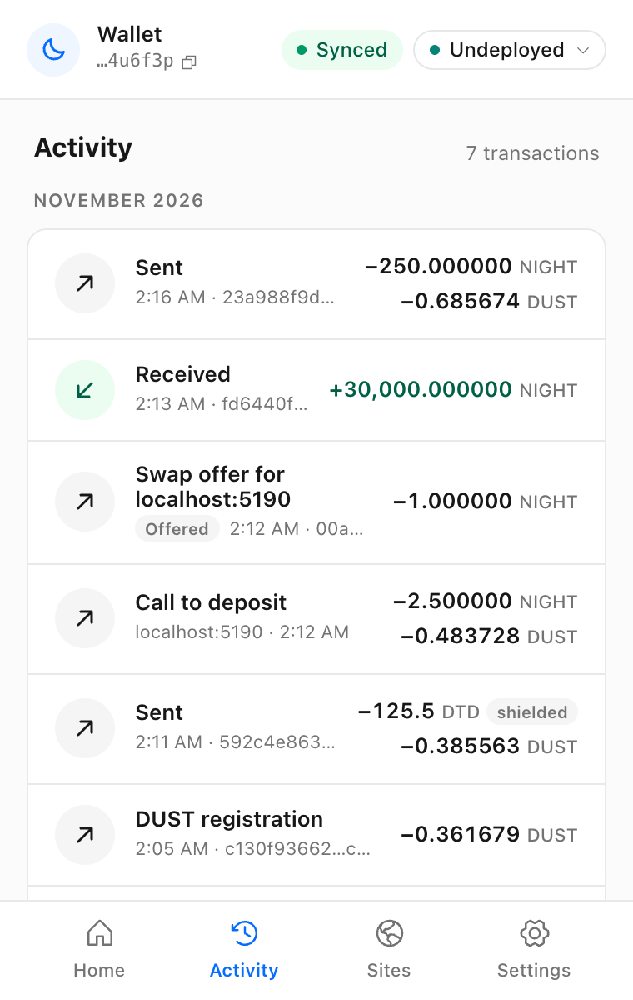</td>
    <td>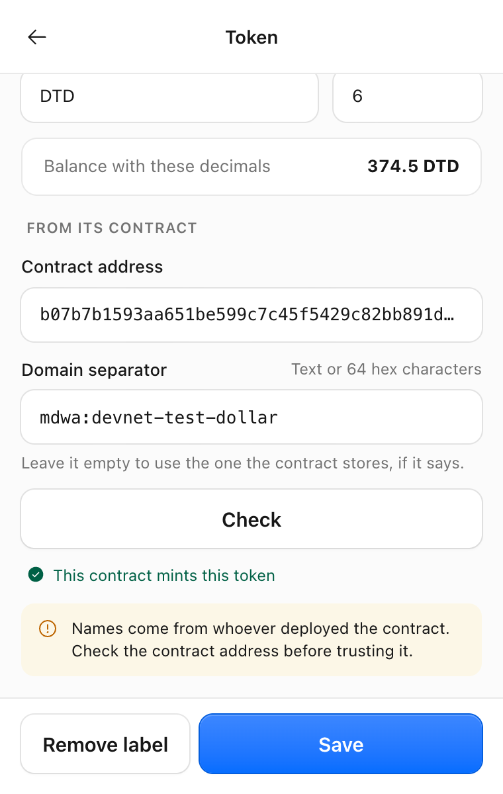</td>
    <td>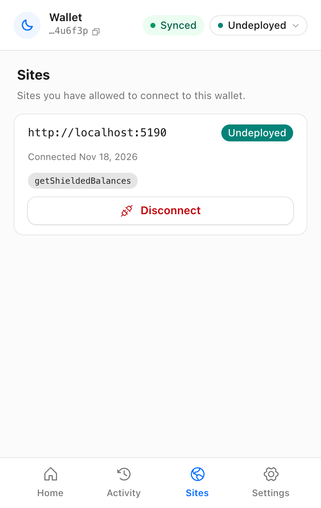</td>
  </tr>
  <tr>
    <td>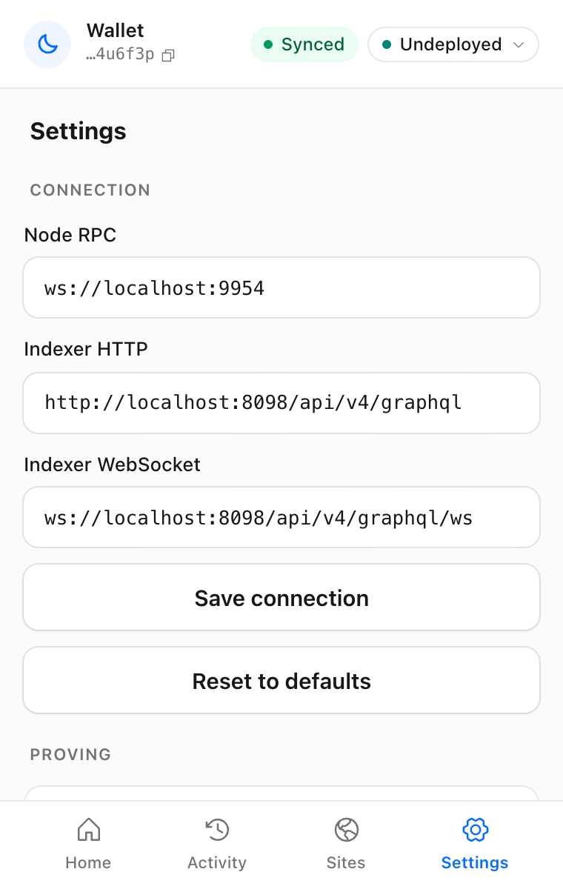</td>
    <td>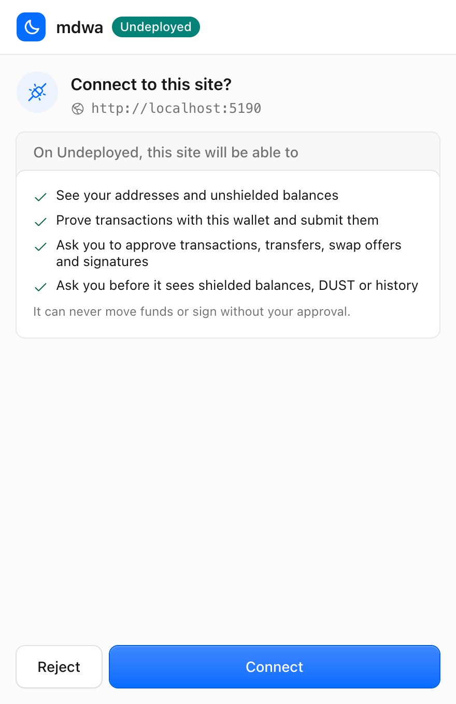</td>
    <td>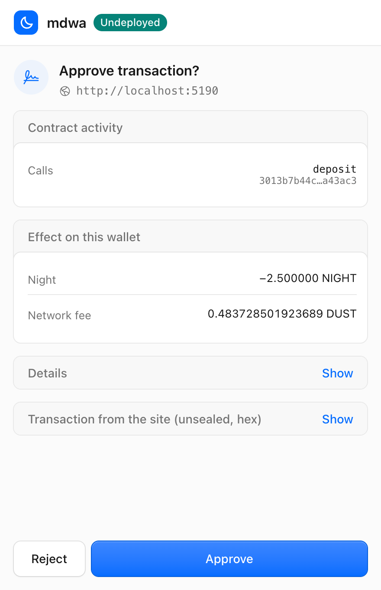</td>
  </tr>
</table>

## Features

- Preview, Preprod, Mainnet and Undeployed, each a separate wallet with its
  own recovery phrase, password, database and site approvals.
- Create a wallet (24 words) or restore one from a recovery phrase, with an
  optional wallet birthday date.
- Three addresses and balances: unshielded, shielded and DUST. NIGHT has 6
  decimals and DUST 15.
- Receive with a QR code for each address; Send NIGHT and other tokens to
  several recipients at once, shielded or unshielded depending on the
  recipient's address, with MAX and a review step. Fees are paid in DUST.
- DUST page: register NIGHT for DUST generation and stop generating again.
- Fast sync: the DUST wallet reads its own DUST through the SDK's projections
  sync instead of replaying every DUST event of the chain, and the shielded
  wallet starts at the wallet birthday (a new wallet's is the block it was
  created at). Live progress for the three wallets, and a snapshot of the
  SDK's state so a browser restart resumes instead of syncing again.
- Proving per network: the SDK's in-browser WASM prover (no extra software)
  or a proof server you run.
- Activity with every token change of every transaction, and a detail page
  for each.
- Custom tokens: Midnight has no token registry, so a custom token is unnamed
  until you label it. Labels are local; a contract address and domain
  separator can be checked against the token type with the ledger.
- Midnight DApp Connector API 4.1.0 (`@midnightntwrk/dapp-connector-api`):
  every `ConnectedAPI` method, per-site permissions, and an approval window
  that shows the balanced transaction's real effect before anything is
  signed. `getProvingProvider` proves a dApp's contract circuits inside the
  wallet. Verified with Midnight.js 5.0.1 by deploying and calling a counter
  contract.
- Every endpoint is editable. Preprod and Mainnet are served through
  Blockfrost and need a project id, which is never given to dApps.
- Unlock once per browser session; while unlocked, sends and approvals need a
  click, not the password.

## Sync

A fresh wallet on Preview used to download about 28 MB and take about 96
seconds to sync, nearly all of it DUST events of other wallets. The DUST wallet
now asks only for its own address's DUST, and a new wallet's shielded sync
starts at the block it was created at, using the zswap Merkle tree the indexer
collapses up to there. Measured on Preview (November 2026): a new wallet synced
in 7 seconds with 1.4 MB, a restore without a date in 15 seconds with 3.4 MB.
Shielded tokens received before a wallet's birthday are not found; a restore
without a date scans the whole chain, and Settings can rescan a wallet from the
start of the chain. See [How sync works](docs/technical.md#how-sync-works).

## Proving time and memory

The in-browser prover is slower than a proof server and uses a lot of memory.
On the development machine a transfer's proofs took about 46 seconds, against
16 to 20 seconds for a whole send with a local proof server; an earlier
measurement of a send with a shielded spend peaked at about 3.5 GB. Proofs run
one at a time, because running them in parallel exhausted memory. A proof server is
the alternative: set it per network in Settings (default
`http://localhost:6300`, the `midnightntwrk/proof-server:9.0.2` image). See
[Proving](docs/technical.md#proving).

## Quick start

```bash
npm ci
```

```bash
npm run build:extension
```

```bash
npm run helium
```

`npm run helium` builds the extension and opens
[Helium](https://helium.computer) with the extension loaded in its own
profile. To use Chrome (116 or newer) instead, run `npm run build:extension`,
open `chrome://extensions`, enable Developer mode, choose **Load unpacked** and
select `build/extension`.

Open the popup, create a wallet on Preview (the default network) and wait for
the sync to reach the chain tip. Send NIGHT to the unshielded address from the
Receive page, then register it for DUST on the DUST page so the wallet can pay
fees. Preprod and Mainnet need a Blockfrost project id in Settings first.

To try the dApp connector, `npm run dapp` serves a local test dApp; see
[The local test dApp](docs/dapp-connector.md#the-local-test-dapp).

## Documentation

- [Technical overview](docs/technical.md): architecture, how sync works, keys
  and unlocking, proving, custom tokens, building, security model and limits,
  repository layout.
- [dApp connector](docs/dapp-connector.md): the API on `window.midnight`, the
  permission model, approval windows, delegated proving, and the local test
  dApp.

## License

Apache-2.0. See [LICENSE](LICENSE).
