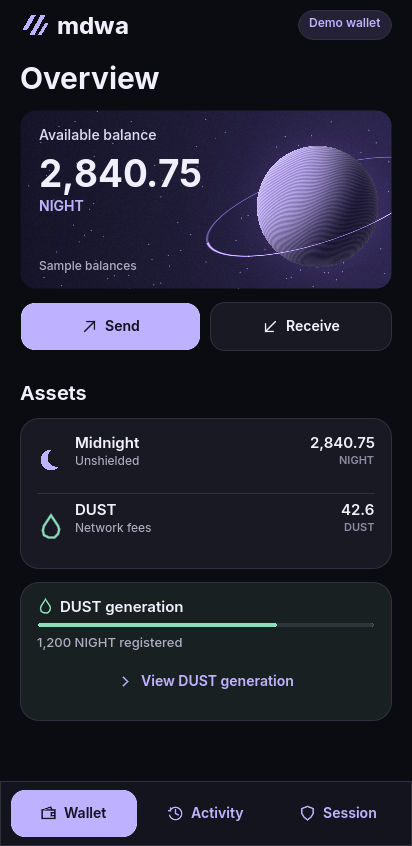

# MDWA for Android

This Android client uses Midnight Preview. Godot draws the controls, text, QR codes and artwork through its mobile Vulkan renderer. The APK bundles the extension’s Midnight SDK worker, proving workers and WASM. A private WebMessagePort connects the UI to the worker in an Android System WebView.



## Use the wallet

Choose **Create wallet** to generate a recovery phrase, record it in order and set a password. **Restore wallet** opens an existing Preview wallet from its phrase and starts its shielded scan at the beginning of the chain. The worker encrypts the vault in the app’s IndexedDB storage. Leaving the app closes the worker and locks the wallet. If you leave during submission, check Activity after unlocking before retrying.

The client shows available NIGHT, shielded and unshielded assets, DUST generation and transaction history. **Receive** displays and copies the selected public, shielded or DUST generation address. **Send** prepares a single public NIGHT transfer for review. DUST registration and deregistration each have a separate fee review. The Chrome extension provides the other networks, multi-recipient sends, token management and dApp connections.

**Explore demo wallet** opens an offline sample with a transfer review and DUST registration walkthrough. Sample balances and confirmations exist only in that session.

## Build and install

Use JDK 17, Android SDK Platform 35 and Build Tools 35, Node.js 24 or newer, and Godot 4.7.2 with Android export support. Set `JAVA_HOME` and `ANDROID_HOME` for your installation. From the repository root run

```sh
npm ci
./android/gradlew -p android :app:assembleDebug
adb install -r android/app/build/outputs/apk/debug/app-arm64-v8a-debug.apk
```

The build generates separate arm64 phone and x86_64 emulator APKs. The app requires Android 9 or newer, Vulkan 1.1 or newer, and a current Android System WebView. The debug build uses the development machine’s Android debug signing key.

## Check the mobile client

From the repository root, after building, run

```sh
godot --headless --path android/ui --script ../check-ui.gd
node android/check-worker.mjs
node android/check-worker.mjs --live
```

The UI check exercises controls, navigation, decimal precision and demo isolation. The worker check uses a disposable Chromium profile to exercise the bundled worker, IndexedDB vault, QR encoding and session locking. Set `CHROMIUM` to your Chromium executable if it is outside `/usr/bin`. The live check creates a fresh throwaway Preview wallet and waits for balances and history. Neither check needs funded coins. Open the desktop demo with `godot --path android/ui`.
